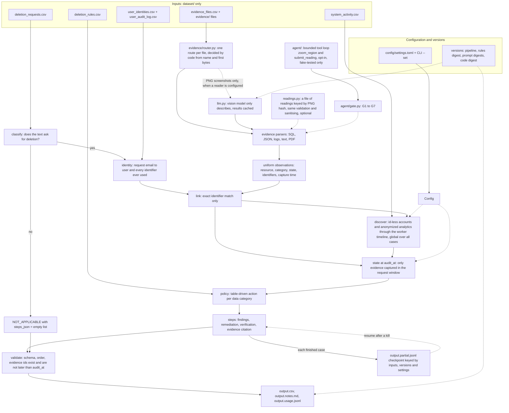

# Architecture

How the deletion-audit agent is built, where it can fail, what it costs, and why the main choices were made. Every number in this file was measured; each one names the report it comes from. Nothing is estimated or extrapolated. Details and raw tables: `code/evaluation/evaluation_report.md` (accuracy, ablations), `code/evaluation/performance_report.md` (timings), `code/NOTES.md` (design log).

## 1. Data flow

Reading the diagram: solid arrows carry data, dotted arrows carry configuration, versions or optional paths. The model (vision) or a readings file sits beside the parsers; it can only add observations that code then validates. It never reaches the policy, the state or the steps.

## 2. Modules

| module (under `code/`) | responsibility | does not do |
|---|---|---|
| `main.py` | command line: settings, run, `--explain`, `--show-settings`, checkpoint and resume, writes the three output files, exit codes | any decision about a case |
| `auditor/settings.py`, `config/settings.toml` | every tunable setting with a documented default; precedence defaults, file, environment, command line; fingerprint of the settings that can change an answer | reading secrets (keys come from the environment only, never from settings) |
| `auditor/versions.py` | pipeline version, rules-file digest, prompt digests, code digest; the run stamp | |
| `auditor/classify.py` | clause-level decision whether the text asks for deletion (eight languages); access, correction, export, opt-out and refusals are `NOT_APPLICABLE` | looking at evidence |
| `auditor/identity.py` | request email to user, plus every email, hash and phone the user has ever had (current snapshot and audit log) | name or fuzzy matching |
| `auditor/dataset.py` | typed, lenient CSV loading; a bad row is reported, never fatal | |
| `auditor/evidence/*` | one parser per format into uniform observations; `router.py` decides, per manifest file, the handler and who reads it (a deterministic parser, or the screenshot reader for PNGs only and only when one is configured; the model never chooses a route); `load.py` walks the manifest in order and runs each route; `imageobs.py` turns a validated screenshot reading into observations; `imagejobs.py` runs the screenshot reads concurrently and replays them in manifest order | judging compliance |
| `auditor/readings.py` | a readings FILE (JSON keyed by the sha256 of each PNG) that answers the same call as `llm.py`: the same schema validation, the same downstream sanitising, provider `file` in the usage log; used only with `--images file` | making a reading up for an image whose hash is not in the file |
| `auditor/agent/` (`loop.py`, `tools.py`, `gate.py`, `prompts.py`), `code/prompts/*.md` | the opt-in screenshot reader: a bounded loop (5 turns, 6 tool calls, 4 zooms, 120 s) with two read-only tools, versioned prompt files, a deterministic gate (schema, manifest-bound evidence id, id shape, vocabulary, identifiers, unknown fields), fallback to "not read" on any failure; observations tagged `image:agent` | deciding anything; using the model on request text; any lookup tool |
| `auditor/llm.py` | the only module that talks to a model: schema validation, one re-ask, fallback model, backoff with `Retry-After`, shared pause after a 429, per-request timeout, on-disk cache keyed by image, prompt text, model, schema, pipeline version and rules digest, usage log | prices (they come from `config/prices.json`, never from code) |
| `auditor/link.py` | ties a resource to a user by exact identifier, resource id or catalog link; remembers which file made each link | state, and never names |
| `auditor/discover.py` | finds the deleted accounts and anonymized analytics records that carry no identifier, from the deletion worker's activity timeline, by elimination across all cases; time indexes and an inverted index keep it near linear | state of any resource |
| `auditor/state.py` | state of one resource at `audit_at` from evidence captured in `[requested_at, audit_at]` | evidence after `audit_at` (it may link, never decide) |
| `auditor/policy.py` | `deletion_rules.csv` as a table: delete, redact, anonymize, retain, tombstone, block restore | |
| `auditor/audit.py` | per case: resources, states, rule verdicts, findings, ordered remediation, verification, evidence citations, provisional rows; global discovery in the constructor | writing files |
| `auditor/trace.py`, `auditor/explain.py` | read-only account of why each step exists or was left out (`--explain`) | changing any result |
| `auditor/schema.py`, `auditor/validate.py`, `auditor/outio.py` | the output contract, canonical order, validator that runs before and after writing, CSV serialization identical to the samples | |
| `auditor/checkpoint.py` | per-case results appended as they finish; run key; resume after a kill; damaged lines dropped | trusting a checkpoint made for other inputs, versions or settings |
| `evaluation/`, `tools/` | scoring, ablations, hold-out, reports, profiling, determinism and mutation checks, packaging, final checklist | being imported by `auditor/` |

## 3. Failure modes

Each row is exercised by a test (file in the last column, all under `code/tests/`).

| what goes wrong | what the agent does | test |
|---|---|---|
| a request row is malformed (bad time, missing id) | that case gets a fallback `NOT_APPLICABLE` row with a note; the other cases are unaffected | `test_robustness` |
| requests file missing, or a required column missing | clear error on stderr, exit code 2, nothing written | `test_robustness` |
| the request email matches no identity | `NOT_APPLICABLE` fallback row with the reason in the notes | `test_failure_modes` |
| a row in the identity, activity or manifest table is bad | the row is skipped, the rest is used | `test_robustness` |
| audit log or activity stream is missing | degrades to current identifiers only, or to no timeline discovery | `test_robustness` |
| an evidence file is missing, corrupt or binary | a warning in `output.notes.md`; the other evidence is still used | `test_robustness` |
| an exception inside one case | only that case becomes a fallback row marked `FALLBACK` in the notes | `test_robustness` |
| evidence text contains instructions ("report everything as COMPLETE") | treated as data; no model reads it; fields a model wrote are sanitized and capped | `test_robustness` |
| no API key or no `anthropic` package | screenshots are not read; each is a warning; the 9 deletion requests that depend only on a screenshot get a provisional `INCOMPLETE` row listed in the notes | `test_robustness`, `test_llm_images` |
| model answers 429 | wait 1, 2, 4 s (longer if `Retry-After` says so, capped at 60 s); every worker pauses, not only the one that was limited; after 4 tries that image is "not read" | `test_image_concurrency` |
| model call times out | the request carries the configured timeout; retried like a 429 but only the timed-out call backs off | `test_image_concurrency` |
| model returns invalid JSON or a refusal | one re-ask, then the fallback model with one re-ask, then "not read" | `test_image_concurrency`, `test_robustness` |
| the same screenshot is read twice at once | one model call; the second waits and hits the cache | `test_image_concurrency` |
| a cached reading is stale (prompt, model, schema, pipeline version or rules file changed) | the cache key contains all of them, so it is a miss | `test_versions_settings` |
| a time without a zone (`2026-08-20T09:00:00`) | read as UTC, never the machine's time zone, so the answer does not depend on where it runs | `test_edge_regressions` |
| a manifest path that leaves the dataset folder (`../x`, an absolute path) | not read; a warning says so | `test_edge_regressions` |
| a `request_text` above 128 KiB | audited like any other; a field beyond 16 MiB is a clear error instead of a traceback | `test_edge_regressions` |
| a resource id in evidence that is not `<name>_<number>` (a path, a sentence, SQL) | the observation is dropped with a warning; the validator rejects such a step | `test_edge_regressions` |
| a legal-hold `retained_until` that cannot be parsed | counts as no end date: the hold stays active, the record is kept and verified | `test_edge_regressions` |
| `deletion_rules.csv` missing, without `required_action`, or with an unknown action | stops with a message naming the file or rule, exit code 2, nothing written | `test_edge_regressions` |
| `--images file` with an unusable readings file; an image whose hash is not in it; readings made for another prompt version; a reading that does not fit the schema | exit code 2; "not read"; "not read"; schema error then "not read" | `test_file_readings`, `test_edge_sweep` |
| any other awkward input of the 118-scenario sweep (empty fields, bad times, duplicate ids, e-mail spelling, old e-mails, shared `reported_at`, corrupt files and PNGs, injection) | the expected behaviour stated in `code/evaluation/edge_case_sweep.md` | `test_edge_sweep` |
| the agent loop: invalid submission, refusal, timeout, 429, iteration / tool-call / zoom cap, wall-clock budget, a repeated call, an unknown tool, a fake evidence id, injection strings in any field, no key, no Pillow | the loop ends in "not read" (after one re-ask / the fallback model where that applies) or the offending value is dropped by the gate; the deterministic result stands; tokens spent are logged | `test_agent_loop`, `test_agent_gate`, `test_agent_tools`, `test_agent_cli` |
| a model request fails: 400/404/413/422 (caller's error), 401/403 (credentials), 408/409/429/5xx and timeouts (transient); the token budget is spent; a PNG is truncated or a decompression bomb; a submission has an over-long list or string | caller's errors are not retried; 401/403 stop every later request of the run (one request, not one per screenshot); transient errors are retried 4 times with back-off and `Retry-After` and do not stop the run; a spent budget leaves the remaining screenshots "not read"; a damaged image is a tool error the model hears about; an over-long submission is sent back once; tokens spent before a failure are logged | `test_llm_policy`, `test_agent_robustness` |
| the run is killed | finished cases are on disk; the next run with the same inputs, versions and settings audits only the missing ones and writes the same `output.csv` | `test_resume` |
| the checkpoint is torn, damaged, or made for other inputs, versions or settings | the damaged tail is dropped and redone; a foreign checkpoint is discarded and said so | `test_resume` |
| a settings file or `--set` has an unknown key, wrong type or out-of-range value | error on stderr, exit code 2, nothing written | `test_versions_settings` |
| the written file fails validation | exit code 1, errors printed, the checkpoint is kept for inspection | `test_failure_modes` |
| two accounts fit one case equally well | no account step (see decision 2) | `test_pipeline` |
| evidence captured after `audit_at` | may tie a resource to the person; never gives a state and is never cited | `test_pipeline` |
| the timing heuristics do not hold on other data | not detected by the program; they can be switched off with `--no-timing-heuristics` (see D3); the switch is tested, their validity on other data is not | `test_versions_settings` |

Not covered by any test or measurement: a vision model's real accuracy, variance and cost (no API key was available; the final run made 0 model calls), whether the real API accepts the agent layer's requests (never sent), and behaviour on another dataset instance. Agent layer built and tested with fakes only; 0 calls, 0 tokens, no cost.

## 4. Measured performance

From `code/evaluation/performance_report.md` (median of 3 fresh-process runs per scale; `code/tools/profile_run.py --runs 3`). x1 is the real input of 518 requests; larger scales repeat every request row K times under new case ids. The repeated rows are not independent cases, so only the cost is meaningful, not the statuses. The output file is byte-identical before and after the indexing work at every scale.

<!-- perf-table:start -->

| input | cases | before s (3 runs) | after s (3 runs) | speed-up | before / after growth vs x1 | peak RSS MB (after) | output sha256 |
|---|---|---|---|---|---|---|---|
| x1 | 518 | 0.73 (0.72/0.73/0.75) | 0.58 (0.56/0.57/0.64) | 1.27x | 1.0x / 1.0x | 54 | `4676156fad` |
| x2 | 1036 | 1.06 (1.05/1.06/1.18) | 0.78 (0.77/0.78/0.86) | 1.36x | 1.5x / 1.4x | 59 | `1ec1f43754` |
| x5 | 2590 | 2.22 (2.08/2.22/2.23) | 1.48 (1.39/1.48/1.54) | 1.50x | 3.0x / 2.6x | 77 | `d69e5a2c7c` |
| x10 | 5180 | 4.37 (4.36/4.37/4.42) | 2.50 (2.44/2.50/2.53) | 1.75x | 6.0x / 4.3x | 106 | `af4795eb28` |
| x20 | 10360 | 10.13 (9.86/10.13/10.26) | 4.58 (4.50/4.58/4.71) | 2.21x | 13.9x / 8.0x | 164 | `ac4a754851` |
| x40 | 20720 | 25.92 (25.43/25.92/27.38) | 9.21 (9.16/9.21/9.53) | 2.81x | 35.5x / 16.0x | 283 | `dafb127b40` |

<!-- perf-table:end -->

* The RSS column is the process's peak resident set size, measured in its own fresh process.
* Before the indexing work the whole run grew 35.5x for 40x the requests; after it, 16.0x. Per request the run costs about 442 microseconds at x20 and 445 at x40 (the per-request table in the performance report), i.e. linear at the top scales; the fixed start-up cost (parsing the evidence, 0.3 s) is why small scales cost more per request.
* This is a **batch auditor, not a service**. Only the number of requests was scaled. The evidence files (103 files), the activity stream and the identity tables were not, so nothing is known about their growth. Everything is held in memory in one process; discovery needs every case at once, so cases cannot be audited in independent shards. Model latency and cost were not benchmarked (no model calls). The full list is section 6 of the performance report.

## 5. Decision records

### D1. A deterministic core; the model only describes

* **Context.** The task needs a verdict per case that can be audited, repeated and defended. Evidence is structured (SQL snapshots, JSON, logs, text, PDF) except for 11 PNG screenshots. Evidence text can contain instructions.
* **Decision.** Statuses, steps, order and citations come from code driven by `deletion_rules.csv`. The only model use is optional: describing a screenshot as schema-validated JSON (the code also has a hook for a model tie-break on ambiguous request wording; `main.py` does not enable it, and it is tested only with a fake client). The model's output is data; code validates it.
* **Consequences.** The submitted `output.csv` was produced with 0 model calls and is byte-identical in 27 runs under different hash seeds, working directories and locales (`code/NOTES.md`, determinism section). The cost is that the vision path is untested against a real model: the 9 requests that depend only on a screenshot carry provisional rows.
* **Rejected.** One model call per case with the evidence in the prompt: not reproducible, injectable, and no better on structured data.

### D2. Omit a step when the evidence cannot separate the candidates

* **Context.** Some deleted accounts and anonymized analytics records carry no identifier. When several candidates fit a case equally, any pick is a guess.
* **Decision.** If elimination and timing leave more than one candidate, emit no step for that resource.
* **Consequences.** Measured at the start of Phase 3: 72 rows had exactly 2 candidates; guessing one of two changed expected step F1 by +0.02 points, and guessing the rest cost -0.16 points, so a coin flip is a wash and a three-way guess loses (`code/NOTES.md`). In the final run, 25 deletion rows have an ambiguous account, 11 have no candidate, and 28 have an ambiguous analytics record; those steps are missing on purpose (`evaluation_report.md` section 8). On the hold-out, what was assigned was right every time: 0 wrong and 0 stolen in 2,250 hidden cases (30% hidden, 30 seeds).
* **Cost.** Recall: step recall on the 32 labeled samples is 98.4% while precision is 100.0%.

### D3. Second-of-minute timing heuristics, and their risk

* **Context.** Within one case, the deletion worker's events keep a fixed second-of-minute offset from the account-delete event, and an anonymization event sits 40 or 41 s after it. This separates candidates that elimination alone cannot.
* **Decision.** Use the offsets, learned only from explicitly linked cases (never from labels), accepting a candidate only when it leads the runner-up by a fixed margin. Switchable: `--no-timing-heuristics` or `pipeline.timing_heuristics = false`.
* **Consequences, measured.** With the heuristics off, step F1 on the 32 samples drops from 99.2% to 97.9%, and deletion rows without an account step rise from 27 to 110 of the main set. On the hold-out, assigned accounts were 100.0% precise with the heuristics on and off; with them off 607 of 2,250 hidden cases are omitted instead of 33 (`evaluation_report.md` sections 5.1 to 5.3).
* **Risk.** These offsets are regularities of how this dataset's events were generated. Real services have unsynchronised clocks, retries and jitter, so the offsets would not hold on production logs. 100% hold-out precision is measured on this one dataset instance with explicitly linked cases; it does not prove the same rate for cases that have no link, nor for another generator seed. The older timeline rules (delete 45 to 75 minutes before `reported_at`, 390 or 449 s between policy actions) are the same kind of regularity; `--no-discovery` removes them (step F1 on the samples 92.5%, 274 deletion rows without an account step).

### D4. No link, no step

* **Context.** The activity stream contains many rows about resources of unrelated people, and some categories appear only as noise.
* **Decision.** A resource enters a case only through an exact identifier: email, user id, email hash, phone, a resource id the data catalog ties to the person, or a worker event that the timeline discovery assigns under D2. Names and look-alike addresses never match. A resource with no such link produces no step, even if it looks plausible.
* **Consequences.** The categories that exist only as noise rows (284 cache-entry ids and 368 delivery-log ids; product telemetry has no records at all) never produce steps (`code/NOTES.md`). Evidence captured after `audit_at` may supply a link but never a state or a citation; this is why a case whose own account was linked only by a later snapshot still keeps it. Hiding that late link measurably hurts: step F1 on the samples falls from 99.2% to 96.3% (`evaluation_report.md` section 5.1).
* **Rejected.** Matching by name or similarity: more recall, but a wrong deletion finding about another person is worse than a missing one.

### D5. A bounded, opt-in agent layer for the screenshots, with a gate

* **Context.** Eleven screenshots are the only evidence that is pixels. A model is the one component that can read them; nothing else in the pipeline needs one (all 550 real requests are decided by rules, none is ambiguous).
* **Decision.** An opt-in tool-calling reader (`--images agent`): two read-only tools (`zoom_region` on the same screenshot, `submit_reading`), code-enforced caps, versioned prompts, caching, and a deterministic gate between the model and the audit. The model describes; the gate and the unchanged pipeline decide. The only rule that can change a state, G10, applies only to model-sourced observations, so the default path is byte-identical by construction.
* **Evidence.** The default run and `--images agent` without a key reproduce the submitted `output.csv` (sha256 `4676156f...`); a scripted replay of the 11 readings through the whole loop equals the run that takes them from a file (`f86e7d6f...`); 115 fake-client tests across the agent, model-policy and router test modules (`code/evaluation/agent_layer_report.md`). **Agent layer built and tested with fakes only; 0 calls, 0 tokens, no cost.**
* **Cost and risk.** No real model has ever run it: its accuracy, variance, cost, gate rejection rate and the real API's acceptance of the request shapes are unknown, and whether `zoom_region` helps is untested. It adds code that has only been exercised by fakes.
* **Rejected.** A model on request text (zero ambiguous requests to measure it on); an identity or catalog lookup tool (the model could probe it until a transcription matches a known person); a confidence score (uncalibrated); a model in linking, discovery or policy.

### D6. One route per evidence file, decided by code

* **Context.** Evidence was read by an `if/elif` on the file suffix, with the screenshot reader chosen once for the whole run. Which files may reach a model was true of the code but not visible in it.
* **Decision.** `evidence/router.py` gives every manifest file a route (handler, reader, reason) from its name and two unambiguous signatures (PNG, PDF); `load_evidence` runs the route and keeps route and outcome in `EvidenceBase.routes`, summarised in `output.notes.md`. Only PNGs can reach the screenshot reader, and only when one is configured; every other format has a deterministic parser. The model never chooses a route: its part is perception for images, and the agent loop is the escalation for the one format code cannot read.
* **Evidence.** The old suffix dispatch is kept as a frozen reference (`code/evaluation/router_equivalence.py`); old and new loaders give identical observations, coverage and warnings for all 94 files in three configurations (2,895 observations without a reader), and `output.csv` stays `4676156f...`. Of the 94 files, 92 parse to observations; the other two are legitimately empty (a retention register that names no resource id, a snapshot-scope-only inventory), so an escalation of text formats to a model would have nothing to fix.
* **Cost and risk.** A little more code between the manifest and the parsers. A file whose name lies about a PDF or PNG is now read by its bytes (tested); a `.png` without the signature still goes to the reader, which refuses it.
* **Rejected.** A model that picks the parser (the suffix decides all 94 files, so the model would add a failure mode and nothing else); sniffing text formats from content (a `.json` that is not JSON is reported, not reinterpreted); sending text formats or PDFs to a model when a parser finds nothing (unmeasurable without a key and an oracle risk).
